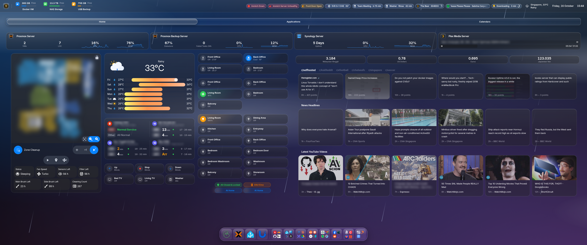
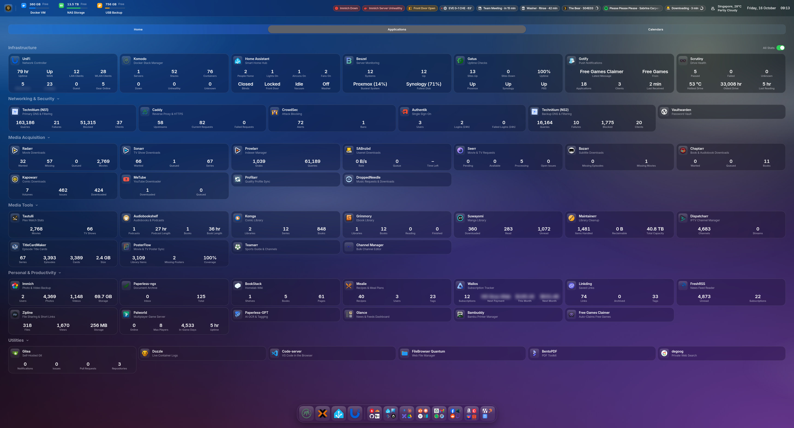
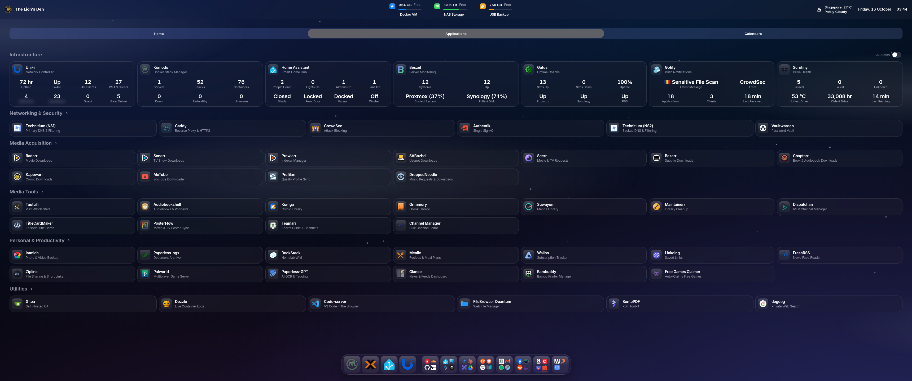
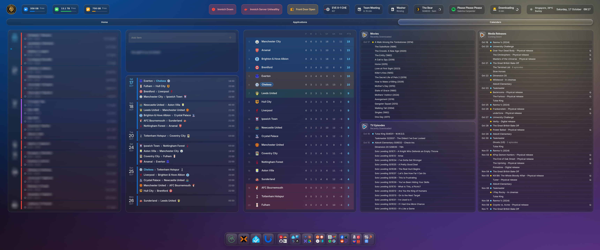
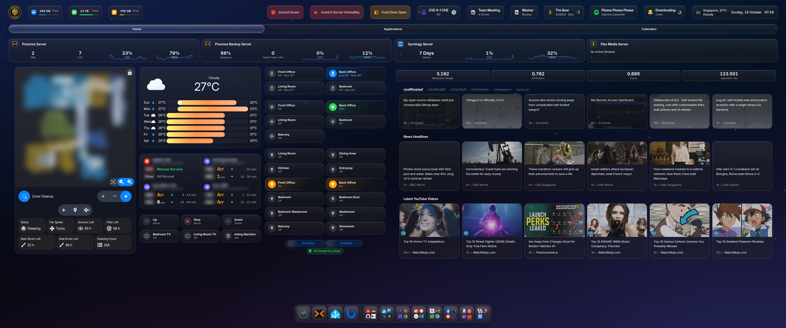
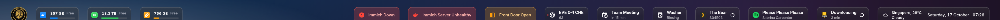
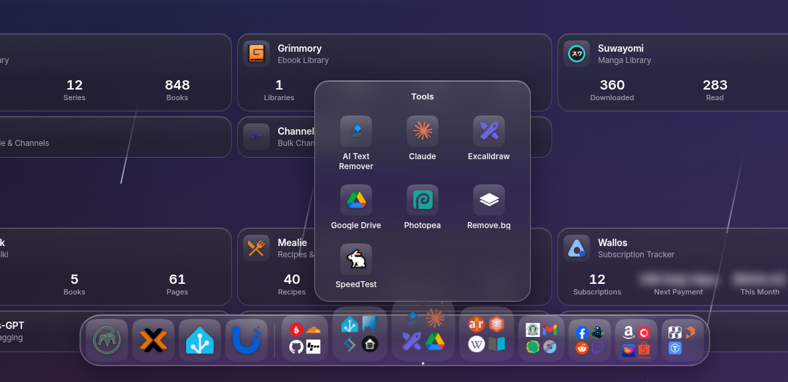
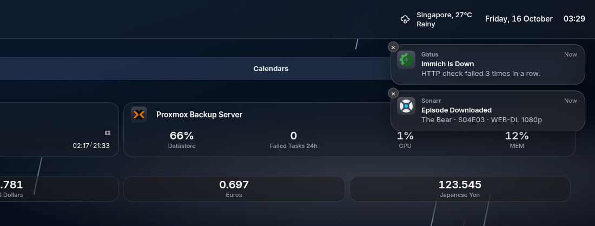
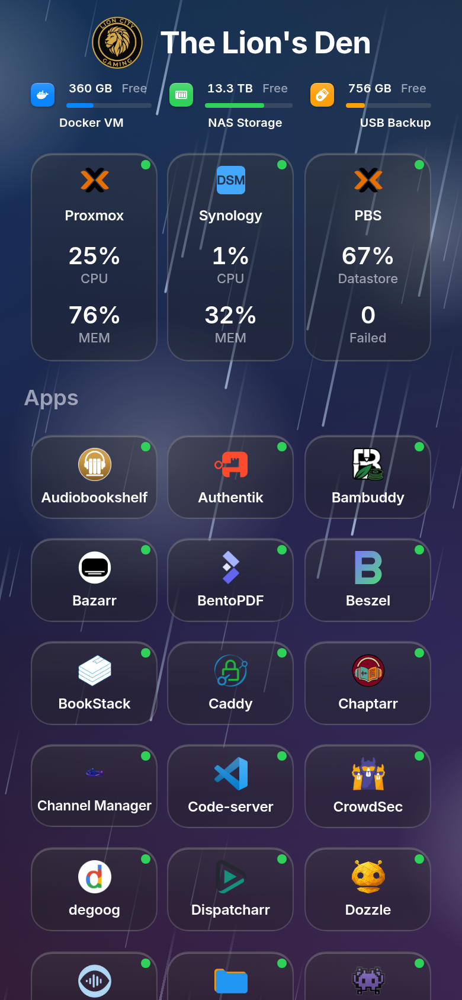

<p align="center">
  
</p>

<h1 align="center">The Lion's Den</h1>

<p align="center">
  <strong>A Liquid Glass <a href="https://gethomepage.dev">Homepage</a> dashboard for a self-hosted homelab</strong><br>
  Clear glass cards in the style of macOS 26, a wallpaper that follows the time of day and the weather, live status boxes in the menu bar, a Dock with bookmark Stacks, and Home Assistant and Glance panels that match it exactly.
</p>

<p align="center">
  <a href="https://github.com/gethomepage/homepage/releases"></a>
  <a href="#license"></a>
  <a href="#tabs"></a>
  <a href="https://github.com/LionCityGaming/homepage/commits/main"></a>
</p>



## Contents

- [Features](#features)
- [Screenshots](#screenshots)
- [Tabs](#tabs)
- [On phones](#on-phones)
- [Address options](#address-options)
- [Files](#files)
- [Setup](#setup)
- [Configuration](#configuration)
- [Extras](#extras)
- [Credits](#credits)
- [License](#license)

## Features

### Liquid Glass

- **Clear glass cards.** Every card is a see-through panel with a light tint, a faint sheen from top to bottom, a bright rim of light along its top edge and a fine hairline, with no blur behind it, so the wallpaper and the weather show through. On standard-resolution screens the hairline is a full pixel, so every browser draws both sides evenly.
- **A glass lens for the open tab.** The tab bar is one glass capsule, and the open tab is a clear lens that glides to the tab you pick, its ends rounded to match.
- **A clear menu bar.** The top bar has no band of its own and lines up with the tab bar: the crest at the left, the disks beside it on glass boxes (names on hover, as the icons say which is which), then Live Activities and one glass box for the weather, date and time on the right.
- **Apple type and icons.** Apple's San Francisco font on Macs and iPhones (Inter everywhere else) with Apple's text levels, one corner size for cards and a smaller one inside them, and every app logo on a light glass squircle in the macOS and iOS icon shape.
- **Matching panels.** The Home Assistant dashboards and the Glance feed shown inside Homepage use the same tint, sheen, rim, hairline and corners, so they read as part of the page (see [Extras](#extras)).
- **One standard look.** Three tiers, each defined once in the STANDARD block of `custom.css`: surfaces (cards, the menu bar's boxes, the tab bar, the Dock), rows inside cards, and floating panels (search, Stacks, banners).

### A living wallpaper

- **Time of day.** Colour fields for night, dawn, day and dusk, drifting very slowly.
- **Weather.** A soft sun when it is clear, drifting clouds, twinkling stars on clear nights, rain falling behind the cards when it rains and the odd flash in a thunderstorm. It follows the same forecast as the weather in the menu bar.

### Live information

- **Live Activities.** Two-line glass boxes in the menu bar, like the disks, that only appear while something is happening: a service or container down (named, with its state), a door open, your football team's kick-off countdown and live score, a meeting in the next 30 minutes, a birthday or public holiday, the washer with its stage, the vacuum's progress, what is playing on Plex (and who is watching) or Spotify, and downloads. Red for problems, amber when something may need you and green for good news, each with a matching edge; a progress ring where there is one, and long lines glide.
- **Notification banners.** A new Gotify message slides in at the top right like a macOS banner, on any tab. Priority 8 and up stays until you close it, lower priorities leave after a few seconds, and 0 to 3 stay quiet.
- **Trend lines.** The CPU and memory figures on the server cards carry a faint line of the last 24 hours, with the day's range on hover.
- **Disk meters.** Each disk in the menu bar has its own icon and colour, turning amber at 75% and red at 90%.
- **Idle dimming.** After 10 minutes without mouse or keyboard the page fades to black with a dim clock that drifts a little every minute, kind to OLED monitors. Any movement brings it back.

### Getting around

- **A Dock.** A glass Dock at the bottom holds your most-used apps, then your bookmark groups as Stacks: folder icons showing their first four links that open a glass grid of the whole group. Icons grow under the pointer and bounce when you open one, and the Stacks read the bookmark groups straight from `services.yaml`. Desktop only.
- **Stats you can fold.** Click a section heading on the Applications tab to fold its figures away, or use the All Stats switch to fold or open every section at once. Folded sections are remembered in the browser.
- **Glass search.** Start typing anywhere and the quick-launch search opens as a glass sheet over the page.
- **Quiet status dots.** Healthy services hide their green dot until you hover them, so the ones that need attention stand out.
- **Calm motion.** Cards grow a touch on hover and sink when clicked, the list cards and embedded panels keep still, and new tabs fade in once their content has settled, with fixed bar heights so nothing jumps. With your system set to reduce motion, cards still grow but without the spring.

## Screenshots

**Applications**, with figures, and with every section folded:





**Calendars:** family calendar and to-do list (blurred), Premier League fixtures and table, recently downloaded films and episodes, and upcoming releases:



**A clear night:** stars behind the glass (`?mood=clear&sky=night`):



**The menu bar** with sample Live Activities (`?live=demo`):



**The Dock** with a bookmark Stack open, and **notification banners** (`?note=test`):





## Tabs

| Tab | What's on it |
|---|---|
| **Home** | Server cards (Proxmox, Proxmox Backup Server, Synology, Plex), a Home Assistant panel, exchange rates and a Glance news feed |
| **Applications** | Every self-hosted app, grouped: Infrastructure, Networking & Security, Media Acquisition, Media Tools, Personal & Productivity, Utilities |
| **Calendars** | Calendars, a to-do list, Premier League fixtures and table, recently downloaded films and episodes, and upcoming releases |
| **Bookmarks** | Everyday links in eight groups. Hidden while the Dock is showing, as its links are the Dock's Stacks; `?dock=0` brings the tab back |
| **Mobile** | A compact status view used automatically on phones (see [On phones](#on-phones)) |

## On phones



Phones get their own compact layout automatically, with no separate app or address:

- The crest and title on one line, and the three disks side by side
- Proxmox, Synology and Proxmox Backup Server as three server cards, each with its two key numbers
- Every app as a small tile, three across, with its status dot always showing, so the page works as a quick health check
- The background still follows the time of day and the weather
- Tabs, the Dock and Live Activities are left out: the Mobile tab is the whole page

<br clear="right">

## Address options

Add these to the Homepage address to preview or switch things. They combine with `&`, for example `?mood=rain&sky=night`.

| Option | What it does |
|---|---|
| `?mood=clear` `partly` `cloudy` `rain` `storm` | Shows that weather mood now |
| `&sky=day` `night` `dawn` `dusk` | With `mood`: the time of day to show it at |
| `?mood=cycle` | Steps through all eight looks, one every 12 seconds, with a caption |
| `?live=demo` | Sample Live Activities |
| `?live=0` | Live Activities off |
| `?note=test` | Two sample notification banners (`?note=hold` keeps both on screen) |
| `?idle=10` | Idle dimming after 10 seconds, to try it (`?idle=0` turns it off) |
| `?dock=0` | No Dock, and the Bookmarks tab comes back |
| `?dock=lite` | A lighter Dock, for a browser that struggles with the full one |
| `?dockbar=fixed` | A Dock bar that keeps its width instead of stretching (`none` hides the bar) |
| `?docksize=72` | Another Dock icon size (default 64) |

## Files

| File | What it does |
|---|---|
| `settings.yaml` | Layout, tabs and theme settings |
| `services.yaml` | Every service and its widgets |
| `widgets.yaml` | The menu bar: crest, title, weather, date, time and disks |
| `custom.css` | The whole look, grouped by part of the page, with the Liquid Glass layer at the end and each part's phone rules beside it |
| `custom.js` | The Live Activities, idle dimming, the Dock and its Stacks, notification banners, the gliding tab lens, trend lines, weather moods, disk colours, the phone layout and small tidy-ups (tidier dates, one row per show in Media Releases, numbers that fit their cards) |
| `.env.example` | Every variable the config uses, with no values |
| `extras/` | Matching styles for Home Assistant and Glance, and small helpers for the Gotify and Beszel cards |
| `screenshots/` | The pictures in this README, taken with sample data and personal details blurred |

## Setup

1. Copy the files into your Homepage `config` folder.
2. Copy `.env.example` to `.env`, fill in what you use, and pass it to the Homepage container (`env_file: .env` in compose). Homepage swaps every `{{HOMEPAGE_VAR_...}}` in the YAML for the matching variable.
3. Delete the services you don't run from `services.yaml`, and their groups from the `layout` in `settings.yaml`.
4. Set your own location in the `openweathermap` widget in `widgets.yaml` and add a free [OpenWeatherMap](https://openweathermap.org/) API key as `HOMEPAGE_VAR_OPENWEATHERMAP_API_KEY`. No key? Swap it for Homepage's `openmeteo` widget, which needs none.
5. Service icons under `/images/icons/` are local files; swap them for [dashboard icons](https://github.com/homarr-labs/dashboard-icons) or your own.

## Configuration

**Cards with two rows of figures.** UniFi, Komodo, Gotify and Beszel show a second row from a second widget on the same card. UniFi's comes from Home Assistant's UniFi Network integration through a long-lived token (`HOMEPAGE_VAR_HOME_ASSISTANT_TOKEN`; a non-admin user is enough, as the card only reads states). Rename the `sensor.<ssid>_clients` entities to your own Wi-Fi networks, and add `sensor.unifi_gear_online` as a Home Assistant template helper with your gateway, access points and switches:

```jinja

{{ gear | select('is_state', 'connected') | list | count }}/{{ gear | count }}
```

**Home Assistant card.** Two rows of three, all from template helpers, as the card only reads states: Lights On, Aircons On and Fans On, then People Home, Server Cost and HA Updates. Server Cost is the monthly cost of the servers' power: a Statistics helper (`sensor.server_power_24h_average`, the mean of your power sensor over 24 hours) and your tariff in `input_number.electricity_tariff`:

```jinja


{{ (w / 1000 * 24 * 30 * t) | round(2) if w is not none and t is not none else none }}
```

`custom.js` shows it with two decimals (Home Assistant drops a trailing zero). HA Updates counts the updates waiting: `{{ states.update | selectattr('state', 'eq', 'on') | list | count }}`.

**Gotify.** The top row shows the newest message and the app it came from. Messages only carry the app's id, so the `remap` list under the Gotify card turns ids into names; fill it with your own apps (the notification banners use the same names, from `NOTE_APPS` in `custom.js`). The second row comes from `extras/gotify-count.sh`, because Gotify's API has no totals.

**Beszel and the trend lines.** The Beszel card's second row (the busiest system and the fullest disk) and the trend lines on the server cards both come from `extras/beszel-summary.py`, a tiny service that logs in to Beszel with the widget's user. It serves the summary at `/` and the last 24 hours of CPU and memory per machine at `/history`, read by a hidden widget on the Beszel card. Match the card names to your Beszel systems in `TREND_CARDS` in `custom.js`.

**Live Activities.** The boxes are a list of sources in `custom.js` (`LIVE_SOURCES`); each reads its data and returns boxes, so adding one is a small block. They read through Homepage's own proxy, so no keys reach the browser. Home Assistant returns at most four readings per widget, so the Home Assistant card carries four hidden extra widgets with the entities the capsules watch (washer, doors, gate, blinds, sun, vacuum, Spotify accounts named "Spotify <name>", calendars); rename them to yours. The Komodo card has two hidden widgets that ask Komodo's read API for every stack and container (`params: {limit: 0}`, as Komodo otherwise answers with one page of 50), so a box can say which one is down. The football team is `LIVE_TEAM` in `custom.js` (ESPN's abbreviation, name and competitions); scores come from ESPN's public scoreboard.

**The Dock.** The apps are the `DOCK` list in `custom.js` (name, address, icon). The links use the domain Homepage itself is opened on, so `homepage.example.com` gives `komodo.example.com` and so on. The Stacks follow `STACKS`, your bookmark group names in the order you want them, and `DOCK_SIZE` sets the icon size.

**Disks and currency.** The disk names that get their own icon and colour are the `DISKS` list in `custom.js`; rename them to match your labels. `custom.js` also shows Singapore dollar amounts as `$` instead of `SGD` (the `currency()` step); change or remove it for your own currency.

## Extras

| File | What it does |
|---|---|
| `extras/home-assistant-glass-embed.js` | Gives Home Assistant dashboards shown inside Homepage the same Liquid Glass look: see-through page, matching tint, sheen, rim and hairline, the same font, no hover effects, and button names too long for their tile glide like Homepage's instead of being cut off. It only applies inside an iframe, so Home Assistant itself looks unchanged. Set `EMBEDS` at the top to your dashboards and add it as a dashboard resource (instructions in the file) |
| `extras/home-assistant-touch-spring.js` | An iOS-style press and bounce for tiles on phone and wall-tablet dashboards, without Android's square tap highlight. Set `PAGES` at the top to your dashboards |
| `extras/glance-glass.css` | The same look for [Glance](https://github.com/glanceapp/glance): add it to the end of your Glance custom CSS |
| `extras/beszel-summary.py` | Serves the Beszel card's second row and the trend-line history. Run it next to Beszel with `BESZEL_USER` and `BESZEL_PASSWORD` set, on the same Docker network as Homepage |
| `extras/gotify-count.sh` | Writes Gotify's real counts for the Gotify card (instructions in the file) |

## Credits

- [Homepage](https://github.com/gethomepage/homepage) by the gethomepage team
- Fonts: Apple's San Francisco (the system font on Apple devices) and [Inter](https://rsms.me/inter/) from Google Fonts everywhere else
- Icons: [Material Design Icons](https://pictogrammers.com/library/mdi/) (embedded) and [dashboard icons](https://github.com/homarr-labs/dashboard-icons)
- Weather: [OpenWeatherMap](https://openweathermap.org/)
- Scores: ESPN's public scoreboard

## License

MIT. Use it, change it, share it.
