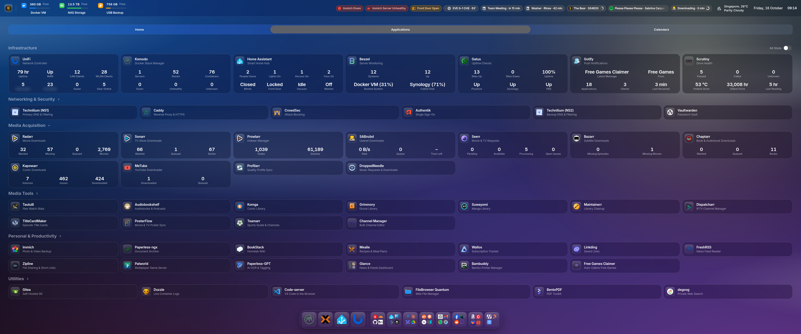
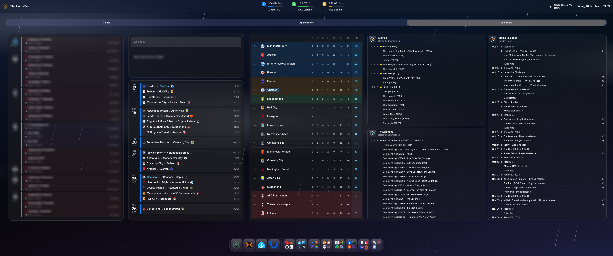

<p align="center">
  
</p>

<h1 align="center">The Lion's Den</h1>

<p align="center">
  <strong>A frosted-glass <a href="https://gethomepage.dev">Homepage</a> dashboard for a self-hosted homelab</strong><br>
  Apple-style glass cards, a background that follows the time of day and the weather, and Home Assistant and Glance panels that blend right in.
</p>

<p align="center">
  <a href="https://github.com/gethomepage/homepage/releases"></a>
  <a href="#license"></a>
  <a href="#services"></a>
  <a href="https://github.com/LionCityGaming/homepage/commits/main"></a>
</p>


---

## Highlights

- **A macOS look.** Every card is a frosted, see-through panel with a hairline edge over a colourful wallpaper, in the style of macOS in dark mode. Apple's own San Francisco font on Macs and iPhones (Inter everywhere else) with Apple's text levels (white for titles, grey for labels and dates), one corner size for cards and a smaller one inside them, and no heavy shadows.
- **App icons on squircles.** Every app logo sits on a light glass plate in the macOS and iOS icon shape.
- **Springy motion.** Cards grow a touch on hover with a slight spring and sink when you click them, tabs press in, the open-tab pill slides to the tab you pick, and the search sheet springs open. The same motion runs in the Home Assistant and Glance panels. With your system set to reduce motion, cards still grow but without the spring.
- **A living wallpaper.** Colour fields that change with the time of day (night, dawn, day, dusk), drift very slowly, and follow the weather: a soft sun when it's clear, drifting clouds, twinkling stars on clear nights, rain when it rains and the odd flash in a thunderstorm. Add `?mood=rain` (or `clear`, `partly`, `cloudy`, `storm`, with `&sky=night` and so on) to the address to preview a mood, or `?mood=cycle` to step through them all.
- **Stats as widget numbers.** Service figures are big numbers over small grey labels, like macOS desktop widgets, and cards shrink their figures to fit narrower screens.
- **Stats you can fold.** Click a section heading on the Applications tab to fold its figures away, or use the All Stats switch beside Infrastructure to fold or open every section at once. Folded sections are remembered in the browser. Each row holds at most seven cards, apps with figures first and the rest after them as compact cards.
- **A menu bar on top.** A thin, straight glass bar like the macOS menu bar: the crest on a squircle plate and the disks on the left, and the weather, date and time on the right in small text.
- **Live Activities.** Compact capsules in the menu bar, just before the weather, that only appear while something is happening, like macOS's Live Activities: a service or container down (named, with its state), the front door open, your football team's kick-off countdown and live score, a meeting in the next 30 minutes, a birthday or public holiday, the washer or dryer with its time left, the vacuum's progress, what's playing on Plex or Spotify, and downloads. Red for problems, amber when something may need you, a progress ring where there is one, and long text scrolls. Add `?live=demo` to the address to see samples, `?live=0` to switch them off.
- **Idle dimming.** After 10 minutes without mouse or keyboard the page fades to black with a dim clock that drifts a little every minute, kind to OLED monitors; any movement brings it back. `?idle=10` tries it after 10 seconds, `?idle=0` turns it off.
- **Disk meters.** Each disk in the top bar has its own icon and colour, turning amber at 75% and red at 90%, and they always sit in the middle of the bar.
- **Glass search.** Start typing anywhere and the quick-launch search opens as a frosted sheet over a dimmed, blurred page.
- **Quiet status dots.** Healthy services don't show a green dot until you hover them, so the ones that need attention stand out.
- **A Dock.** A frosted macOS Dock at the bottom holds your most-used apps, then your bookmark groups as Stacks: each group is a folder icon showing its first four links, and a click opens a frosted grid of the whole group above it. Icons grow as the pointer passes over them and bounce when you open one. The Stacks read the bookmark groups straight from `services.yaml`, so they always match. Desktop only.
- **Notification banners.** A new Gotify message slides in at the top right like a macOS banner, on any tab. Priority 8 and up stays until you close it; lower priorities leave after a few seconds, and 0 to 3 stay quiet. Add `?note=test` to the address to see two samples.
- **Smooth tab switching.** A newly opened tab stays hidden for a moment while its content settles, then fades in once, and embedded pages fade in after they load instead of flashing a loading screen. The bar heights are fixed so nothing jumps, and the Dock's magnification moves only transforms, so it stays smooth.
- **Embedded panels that match.** Home Assistant dashboards and Glance are shown inside Homepage with the same glass look (see [Extras](#extras)).


## Tabs

| Tab | What's on it |
|---|---|
| **Home** | Server stats (Proxmox, PBS, Synology, Plex), a Home Assistant panel, exchange rates and a Glance news feed |
| **Applications** | Every self-hosted app, grouped: Infrastructure, Networking & Security, Media Acquisition, Media Tools, Personal & Productivity, Utilities |
| **Bookmarks** | Everyday links: 3D Printing, Homelab, Homelab Help, Reference, Shopping, Social & Media, Tools, Work & Admin. Hidden while the Dock is showing, because its links are the Dock's Stacks; add `?dock=0` to the address to get the tab back |
| **Calendars** | Calendars, a to-do list, Premier League fixtures and table, recently downloaded films and episodes, and upcoming releases |
| **Mobile** | A compact status view used automatically on phones (see [On phones](#on-phones)) |

The tab bar works like a macOS segmented control: one grey track, with the open tab as a raised dark-grey segment that slides to the next tab you pick.


With every section folded (All Stats off), and with only Media Acquisition open:




The Dock with a bookmark Stack open:


A Gotify message arriving as a banner (the `?note=test` samples):




## On phones


Phones get their own compact layout automatically (no separate app or URL):

- The crest and title on one line, and the three disks side by side
- Proxmox, Synology and Proxmox Backup Server as three server cards, each with its two key numbers
- Every app as a small tile, three across, with its status dot always showing so the page works as a quick health check
- The weather capsule is left out (the phone already shows the weather), but the background still follows it
- Tabs are hidden: the Mobile tab is the whole page

<br clear="right">

## Files

| File | What it does |
|---|---|
| `settings.yaml` | Layout, tabs and theme settings |
| `services.yaml` | Every service and its widget |
| `widgets.yaml` | The top bar: crest, title, weather, date, time and disks |
| `custom.css` | The whole look, grouped by part of the page (page and background, cards, status dots, tabs, top bar, embedded panels, Calendars lists, search, motion), each part with its own phone rules |
| `custom.js` | Small helpers: the Live Activities, idle dimming, the Dock and its Stacks, the notification banners, the sliding tab pill, section colours, disk colours and icons, the clock layout, time-of-day and weather moods, the phone layout, Bookmarks columns arranged as a peak (most links in the middle), tidier dates in the Calendars lists, and one row per show in Media Releases when several episodes come out on the same day ("The Terminal List · 8 episodes", every episode in its tooltip), matching labels for the few widgets that word theirs differently (UniFi's users are called clients), phone app names that shrink to fit their tile, the CrowdSec prefix taken off Gotify alert titles, and Technitium counts without their percentages |
| `.env.example` | Every variable the config uses, with no values |
| `extras/` | Matching styles for Home Assistant and Glance, and two small helpers for the Gotify and Beszel cards |

## Setup

1. Copy the files into your Homepage `config` folder.
2. Copy `.env.example` to `.env`, fill in what you use, and pass it to the Homepage container (`env_file: .env` in compose). Homepage swaps every `{{HOMEPAGE_VAR_...}}` in the YAML for the matching variable.
3. Delete the services you don't run from `services.yaml`, and their groups from the `layout` in `settings.yaml`.
4. Set your own location in the `openweathermap` widget in `widgets.yaml` (it's set to Singapore) and add a free [OpenWeatherMap](https://openweathermap.org/) API key as `HOMEPAGE_VAR_OPENWEATHERMAP_API_KEY`. No key? Swap it for Homepage's `openmeteo` widget, which needs none.
5. Service icons under `/images/icons/` are local files; swap them for [dashboard icons](https://github.com/homarr-labs/dashboard-icons) or your own.

The UniFi, Komodo and Gotify cards have two rows of figures, each from a second widget on the same card. UniFi's second row comes from Home Assistant's UniFi Network integration through a long-lived token (`HOMEPAGE_VAR_HOME_ASSISTANT_TOKEN`; a non-admin user is enough, as the card only reads states). Rename the `sensor.<ssid>_clients` entities to your own Wi-Fi networks, and make `sensor.unifi_gear_online` as a Home Assistant template helper (Settings, Helpers, Template sensor) with your gateway, access points and switches:

```jinja

{{ gear | select('is_state', 'connected') | list | count }}/{{ gear | count }}
```

Gotify's top row shows the newest message and the app it came from. Its messages only carry the app's id, so the `remap` list under the Gotify card turns ids into names; fill it with your own apps (the notification banners use the same names, from `NOTE_APPS` in `custom.js`). The second row (Applications, Clients, Last Received) comes from `extras/gotify-count.sh`, which reads Gotify's database every 15 seconds and writes the counts where Homepage can serve them, because Gotify's API has no totals.

The Beszel card's second row (the busiest system and the fullest disk across every machine) comes from `extras/beszel-summary.py`, a tiny service that logs in to Beszel with the widget's user and serves the summary to Homepage. The Scrutiny and Gatus cards read their APIs directly.

Live Activities are a list of sources in `custom.js` (`LIVE_SOURCES`); each reads its data and returns capsules, so adding one is a small block. They read through Homepage's own proxy, so no keys reach the browser: Tautulli (the Plex card on Home), SABnzbd, Gatus, Scrutiny, Komodo, and Home Assistant. Home Assistant returns at most four readings per widget, so the Home Assistant card carries four hidden extra widgets with the entities the capsules watch (washer, doors, gate, blinds, sun, vacuum, Spotify accounts named "Spotify <name>", calendars); rename them to yours. The Komodo card has two hidden extra widgets that ask Komodo's read API for every stack and container, so a capsule can say which one is down. The football team is `LIVE_TEAM` in `custom.js` (ESPN's abbreviation, name and competitions); scores come straight from ESPN's public scoreboard.

The Dock's apps are the `DOCK` list in `custom.js` (name, address, icon); the links use the domain Homepage itself is opened on, so `homepage.example.com` gives `komodo.example.com` and so on. The Stacks follow `STACKS`, a list of your bookmark group names in the order you want them, and `DOCK_SIZE` sets the icon size (`?docksize=72` previews another).

The disk names that get their own icon and colour (`Docker VM`, `NAS Storage`, `USB Backup`) are set in the `DISKS` list in `custom.js`, so rename them there to match your own labels. `custom.js` also shows Singapore dollar amounts as `$` instead of `SGD` (the `currency()` step); change or remove it for your own currency.

## Extras

- **`extras/home-assistant-glass-embed.js`** makes Home Assistant dashboards that are embedded in Homepage see-through, with glass cards, the same font and the same springy hover on small cards. It only kicks in when a dashboard is shown inside an iframe, so Home Assistant itself looks unchanged. Instructions are at the top of the file.
- **`extras/home-assistant-touch-spring.js`** gives Home Assistant dashboards on phones and wall tablets an iOS-style press and bounce on their tiles, and switches off Android's square tap highlight. Set `PAGES` at the top to your dashboards.
- **`extras/gotify-count.sh`** writes Gotify's real counts for the Gotify card (instructions at the top).
- **`extras/beszel-summary.py`** serves the busiest system and fullest disk for the Beszel card (instructions at the top). Run it next to Beszel with `BESZEL_USER` and `BESZEL_PASSWORD` set, on the same Docker network as Homepage.
- **`extras/glance-glass.css`** does the same for [Glance](https://github.com/glanceapp/glance): add it to the end of your Glance custom CSS.

## Credits

- [Homepage](https://github.com/gethomepage/homepage) by the gethomepage team
- Fonts: Apple's San Francisco (the system font on Apple devices) and [Inter](https://rsms.me/inter/) from Google Fonts everywhere else
- Icons: [Material Design Icons](https://pictogrammers.com/library/mdi/) (embedded) and [dashboard icons](https://github.com/homarr-labs/dashboard-icons)
- Weather: [OpenWeatherMap](https://openweathermap.org/) (free API key), the same source as the Home Assistant weather card

## License

MIT. Use it, change it, share it.
